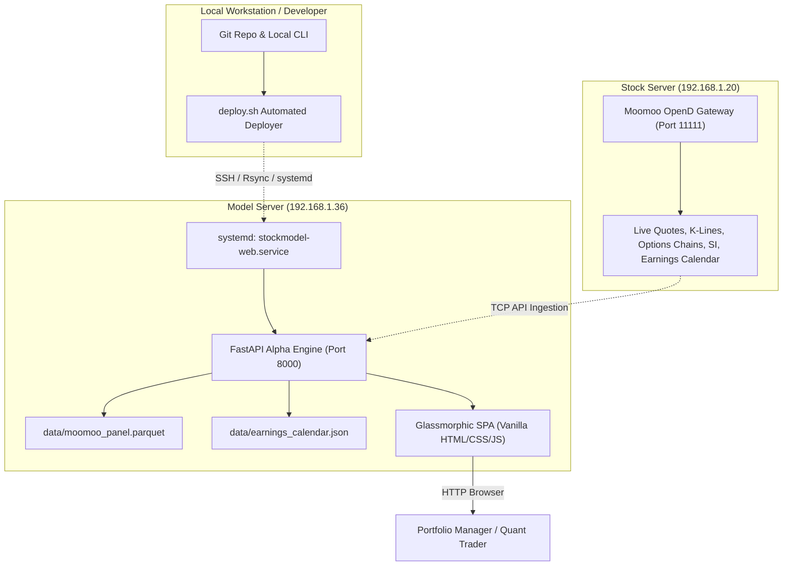

# StockModel Alpha Platform — User Guide & Operator Manual

Comprehensive operator manual and user guide for the **StockModel Alpha Platform**, an institutional-grade quantitative swing trading and cross-sectional alpha research engine.

---

## Table of Contents

1. [System Architecture & Network Topology](#1-system-architecture--network-topology)
2. [Quick Start & Accessing the Web Dashboard](#2-quick-start--accessing-the-web-dashboard)
3. [Web Dashboard User Interface Walkthrough](#3-web-dashboard-user-interface-walkthrough)
   - [Top Navigation & Telemetry Bar](#top-navigation--telemetry-bar)
   - [Tab 1: Live Decile Rankings & Portfolio Allocation](#tab-1-live-decile-rankings--portfolio-allocation)
   - [Tab 2: Backtest Simulation & Performance Tearsheet](#tab-2-backtest-simulation--performance-tearsheet)
   - [Tab 3: Complexity Gating (GBDT vs Linear Baseline)](#tab-3-complexity-gating-gbdt-vs-linear-baseline)
   - [Tab 4: Feature Ablation Study (Predictive Attribution)](#tab-4-feature-ablation-study-predictive-attribution)
   - [Tab 5: Architecture & Model Specifications](#tab-5-architecture--model-specifications)
4. [Step-by-Step Daily Operating Workflows](#4-step-by-step-daily-operating-workflows)
   - [Workflow A: Review Daily Target Allocations](#workflow-a-review-daily-target-allocations)
   - [Workflow B: Ingest Live Data from Moomoo OpenD](#workflow-b-ingest-live-data-from-moomoo-opend)
   - [Workflow C: Export Allocations for Execution](#workflow-c-export-allocations-for-execution)
   - [Workflow D: Run Custom What-If Backtests](#workflow-d-run-custom-what-if-backtests)
5. [Understanding Earnings Lifecycle Indicators](#5-understanding-earnings-lifecycle-indicators)
6. [Command-Line Interface (CLI) Reference](#6-command-line-interface-cli-reference)
7. [REST API Documentation](#7-rest-api-documentation)
8. [Automated Deployment & Production Operations](#8-automated-deployment--production-operations)
9. [Troubleshooting & Frequently Asked Questions](#9-troubleshooting--frequently-asked-questions)

---

## 1. System Architecture & Network Topology

The StockModel platform operates across a synchronized multi-node infrastructure designed for low-latency market ingestion, high-throughput machine learning inference, and high-availability web serving:



### Server Roles

| Server Node | Hostname / IP | Port | Primary Responsibility |
| :--- | :--- | :--- | :--- |
| **Data Node** | `stockserver` (`192.168.1.20`) | `11111` | Runs Moomoo OpenD gateway supplying live historical daily bars, real-time quotes, options open interest/implied volatility, short interest, and corporate action schedules. |
| **Model Server** | `modelserver` (`192.168.1.36`) | `8000` | Runs the continuous `stockmodel-web.service` production daemon hosting the quantitative ranking engine, LightGBM ranker, backtest simulator, and web dashboard. |
| **Local Workstation** | `workstation` | — | Pair programming, local model research, git source control, and automated deployment script runner. |

---

## 2. Quick Start & Accessing the Web Dashboard

### Accessing the Live Web Dashboard
Open your web browser and navigate to:
```
http://modelserver:8000/
```
*(Alternatively, use `http://192.168.1.36:8000/` if DNS hostname resolution is not configured).*

### Starting the Web Dashboard Locally
If you want to run the application on your local development workstation:

```bash
# 1. Navigate to repository root
cd /home/shawn/git/StockModel

# 2. Activate virtual environment
source .venv/bin/activate

# 3. Launch the dashboard server
stockmodel serve --host 0.0.0.0 --port 8000
```
Then navigate to `http://localhost:8000/`.

---

## 3. Web Dashboard User Interface Walkthrough

The web user interface is built as a dark-theme, responsive single-page application (SPA) featuring real-time data streaming, Chart.js financial charts, and interactive filtering.

### Top Navigation & Telemetry Bar

The top header bar provides critical status indicators and global operational controls:


1. **Platform Badge:** Displays current system version (`v0.1.0`), core horizon (`2–4W Swings`), and universe size.
2. **Server Telemetry Pill:** Displays real-time server hostname (`modelserver`), connection health (`Online`), CPU count, and RAM availability.
3. **Moomoo Gateway Status Pill:**
   - **`Online (52 assets, 12,600+ bars)` (Green):** OpenD is connected on `192.168.1.20:11111` and market data panel is cached.
   - **`Offline` (Red):** Gateway connection lost.
4. **Data Source Dropdown:**
   - **`Live Moomoo OpenD`:** Evaluates live equities data ingested directly from the stockserver.
   - **`Synthetic Simulation`:** Generates high-fidelity geometric Brownian motion and jump-diffusion market panels with realistic cross-sectional correlation.
5. **Lookback Selector:** Choose between 60, 120, 252 (1 Year), or 504 (2 Years) trading days.
6. **"Sync Live Data" Button:** Opens the on-demand ingestion modal to pull latest bars, options chains, and earnings calendars from `stockserver`.

---

### Tab 1: Live Decile Rankings & Portfolio Allocation

This is the primary operational screen used for daily portfolio rebalancing and trade generation.

```
┌──────────────────────────────────────────────────────────────────────────────────────────────────┐
│  PORTFOLIO EXPOSURE SUMMARY                                                                      │
│  Gross Exposure: 100.0%  │  Net Exposure: 0.0%  │  Longs: 5 (50.0%)  │  Shorts: 5 (-50.0%)       │
└──────────────────────────────────────────────────────────────────────────────────────────────────┘
```

#### Key Components:
- **Allocation Chart:** Bar chart showing portfolio weights across all 50+ assets. Green bars denote long allocations, red bars denote short candidates.
- **Filter Pills:** Quickly isolate `All Positions`, `Longs Only`, or `Shorts Only`.
- **"Export Allocation CSV" Button:** Generates a downloadable CSV containing timestamps, weights, rank scores, prices, ATR(14), and earnings metadata ready for upload to execution systems.
- **Rankings Table Columns:**
  - **Ticker:** Symbol (e.g., `AMZN`, `AAPL`, `MSFT`).
  - **Type:** Position classification (`LONG`, `SHORT`, or `FLAT`).
  - **Weight:** Target portfolio percentage scaled by inverse-ATR(14) risk weighting.
  - **Rank Score:** LightGBM out-of-sample predicted alpha score $[-1.0, 1.0]$.
  - **Last Close & ATR (14d):** Most recent daily closing price and 14-day Average True Range volatility measure.
  - **Days to Earnings:** Point-in-time calculation showing exact trading days until next announcement, plus subtext showing recent past announcement dates.
  - **Status Badge:**
    - `<span class="badge-tag active">Active</span>`: Position eligible for rebalance.
    - `<span class="badge-tag blackout">⚠️ Blackout</span>`: Within 3 days of earnings; new entry forbidden.
    - `<span class="badge-tag post-earnings">🎉 Post-Earnings (1d ago)</span>`: Reported within the last 10 days; highlighted for Post-Earnings Announcement Drift (PEAD).
  - **Sector:** GICS sector classification for sector-neutral balance monitoring.

---

### Tab 2: Backtest Simulation & Performance Tearsheet

Simulates cross-sectional walk-forward execution under strict execution constraints:

- **Interactive Equity Curve:** Cumulative Net Asset Value (NAV) comparison between the Quantitative Strategy and a Buy & Hold benchmark.
- **Underwater Drawdown Chart:** Peak-to-trough drawdown distribution highlighting tail risk.
- **Performance Tearsheet Metrics:**
  - **Annualized Return:** Compound annual growth rate.
  - **Sharpe Ratio:** Volatility-adjusted return above risk-free rate.
  - **Sortino Ratio:** Downside-risk-adjusted return.
  - **Calmar Ratio:** Annualized return over maximum drawdown.
  - **Maximum Drawdown:** Peak-to-trough decline.
  - **Portfolio Turnover:** Annual turnover percentage under inertia band filtering.
  - **Execution Friction:** Cumulative basis points consumed by bid-ask slippage (8 bps large / 15 bps mid cap) and short borrow fees (100 bps / year).
- **Interactive Controls:** Sliders to stress-test **Rebalance Frequency** (1–20 days) and **Turnover Inertia Exit Percentile** (10%–90%).

---

### Tab 3: Complexity Gating (GBDT vs Linear Baseline)

Guards against overfitting and unnecessary model complexity by enforcing an automated empirical gate:

- **Hurdle 1 (Minimum Out-of-Sample IC):** LightGBM ranker must achieve $\text{OOS IC} \ge 0.035$.
- **Hurdle 2 (Minimum Information Stability ICIR):** LightGBM ranker must achieve $\text{ICIR} \ge 0.75$.
- **Hurdle 3 (Benchmark Dominance):** LightGBM must beat the ElasticNet linear baseline in $\text{OOS IC}$ across purged & embargoed walk-forward splits.
- **Status Banner:** Displays `APPROVED FOR LIVE DEPLOYMENT` (Green) or `REJECTED — REVERT TO LINEAR` (Red).

---

### Tab 4: Feature Ablation Study (Predictive Attribution)

Performs leave-one-feature-out sensitivity analysis across the 7 core alpha features:

- Evaluates $\Delta\text{IC}$ and $\Delta\text{Sharpe}$ when each feature is individually omitted.
- **Automated Recommendation:**
  - `KEEP` (Green Badge): Removing this feature causes severe degradation in predictive power; feature is essential.
  - `PRUNE` (Red Badge): Removing this feature improves or does not impact OOS IC; candidate for removal to reduce noise.

---

### Tab 5: Architecture & Model Specifications

A live interactive technical reference detailing:
- Mathematical formulas for all 7 features.
- Portfolio construction formulas (Inverse-ATR risk parity).
- Complete system architecture flowchart.
- Live configuration hyperparameter inspection.

---

## 4. Step-by-Step Daily Operating Workflows

### Workflow A: Review Daily Target Allocations
**Frequency:** Daily at market close or pre-market opening.

1. Navigate to `http://modelserver:8000/`.
2. Confirm the top right data source selector is set to **`Live Moomoo OpenD`**.
3. View the **Decile Rankings** table:
   - Identify candidate assets in the **`LONG`** decile (highest predicted scores).
   - Identify candidate assets in the **`SHORT`** decile (lowest predicted scores).
4. Review the **Days to Earnings** and **Status** column:
   - Ensure no entries are marked `⚠️ Blackout`. If an asset has upcoming earnings in $\le 3$ days, the engine automatically trims or flat-lines its target weight.
   - Note assets flagged with `🎉 Post-Earnings`. These assets have just reported earnings and exhibit post-earnings momentum.
5. Filter by `Longs Only` to inspect long book gross risk.

---

### Workflow B: Ingest Live Data from Moomoo OpenD
**Frequency:** Weekly on Friday evening or daily after market close (16:30 ET).

1. In the dashboard header, click **"Sync Live Data"**.
2. A modal dialog opens showing:
   - OpenD Gateway State: `Online (192.168.1.20:11111)`.
   - Current cached panel dates and total bars.
3. Specify parameters:
   - **Lookback Window:** Default `252` trading days (1 year).
   - **Universe:** Leave blank for default 50+ diversified liquid equities, or enter custom comma-separated symbols (e.g., `AAPL,NVDA,MSFT,AMZN,GOOGL`).
4. Click **"Start Ingestion"**.
5. The system performs:
   - Daily k-line bar collection (OHLCV + VWAP).
   - Snapshot market capitalization and P/E ratios.
   - ATM options chain analysis (Net Gamma Exposure and Call/Put volume).
   - Official short interest history.
   - Throttled earnings calendar extraction with local caching in `data/earnings_calendar.json`.
6. Once complete, a success toast notification appears and the dashboard refreshes automatically.

---

### Workflow C: Export Allocations for Execution
**Frequency:** When rebalancing orders need to be sent to your broker or Execution Management System (EMS).

1. On the **Decile Rankings** tab, click **"Export Allocation CSV"**.
2. The browser automatically downloads a timestamped file:
   ```
   stockmodel_allocations_YYYY-MM-DD.csv
   ```
3. The exported CSV contains structured columns:
   ```csv
   Symbol,Type,Weight_Pct,Pred_Score,Last_Close,ATR_14,Days_To_Earnings,Days_Since_Earnings,Last_Earnings_Date,Next_Earnings_Date,Is_Post_Earnings,In_Blackout,Sector
   AMZN,LONG,10.25,0.0842,240.35,7.71,64,1,2026-10-29,2027-01-28,true,false,Consumer Discretionary
   AAPL,FLAT,0.0,0.0579,344.63,6.70,1,66,2026-07-30,2026-11-02,false,true,Technology
   ```

---

### Workflow D: Run Custom What-If Backtests
**Frequency:** During strategy optimization or research sessions.

1. Navigate to the **Backtest Simulation** tab.
2. Adjust the sliders in the control panel:
   - **Rebalance Frequency:** Adjust from 5 days (weekly) down to 1 day (daily) or up to 20 days (monthly).
   - **Inertia Exit Percentile:** Adjust from 0.40 to 0.80 to evaluate how holding onto winners reduces execution friction and trading slippage.
3. Click **"Run Backtest Simulation"**.
4. The simulation engine runs asynchronously and updates the equity curve, Sharpe/Sortino ratios, and turnover stats in real time.

---

## 5. Understanding Earnings Lifecycle Indicators

The platform enforces strict rules to prevent holding equities through high-volatility, binary earnings announcements:

```
                  ◄─── EARNINGS BLACKOUT ───► ◄─── POST-EARNINGS WINDOW ───►
  ───────┬───────────────────────────┬───────────────┬─────────────────────────┬─────────► Timeline
         │                           │               │                         │
     DTE > 3                     DTE ≤ 3          Day 0                     0 < DSE ≤ 10
   [ Active ]               [ ⚠️ Blackout ]   [ Earnings ]             [ 🎉 Post-Earnings ]
   Normal Trading           Entry Forbidden   Announcement             PEAD Drift Trades
                            50% Trim @ 48h                             ~64 Days to Next
```

### Lifecycle States

| Indicator | Status Text / Badge | Strategy Action | Explanation |
| :--- | :--- | :--- | :--- |
| **Normal Holding** | `<span class="badge-tag active">Active</span>` | Eligible for Long/Short | Days to earnings $> 3$. Stock is outside binary risk window. |
| **Entry Blackout** | `<span class="badge-tag blackout">⚠️ Blackout</span>` | **Entry Forbidden** | Scheduled earnings report is $\le 3$ trading days away (e.g., AAPL). Model prevents entering new exposure. |
| **Risk Trim** | `<span class="badge-tag blackout">⚠️ Blackout Trim</span>` | **50% Trim / Exit** | Holding reaches 48 hours prior to announcement. Position is trimmed by 50% or closed to protect against gap risk. |
| **Post-Earnings** | `<span class="badge-tag post-earnings">🎉 Post-Earnings</span>` | **Momentum / PEAD** | Stock announced earnings within the last 10 trading days (e.g., AMZN, MSFT, GOOGL). Next report is projected ~64 trading days forward. |

> [!NOTE]
> **OpenD Rate Limit Protection:** OpenD enforces a rate limit of 30 queries per 30 seconds for earnings history. All 52 universe assets are persistently cached in [`data/earnings_calendar.json`](file:///home/shawn/git/StockModel/data/earnings_calendar.json). This guarantees instantaneous dashboard loading and zero API throttling.

---

## 6. Command-Line Interface (CLI) Reference

The `stockmodel` CLI provides direct access to all alpha engine routines from terminal scripts or cron tasks:

```bash
# Activate python environment
source .venv/bin/activate
```

### 1. Ingest Live Data from OpenD
```bash
stockmodel fetch-moomoo --host 192.168.1.20 --days 252 --output data/moomoo_panel.parquet
```
*Options:*
- `--host HOST`: Moomoo OpenD host IP (default: `192.168.1.20`).
- `--port PORT`: OpenD port (default: `11111`).
- `--days DAYS`: Lookback calendar window (default: `252`).
- `--output PATH`: Destination parquet path (default: `data/moomoo_panel.parquet`).
- `--tickers SYMBOLS`: Comma-delimited list of tickers to fetch.

### 2. Generate Real-Time Rankings
```bash
# Using live moomoo panel
stockmodel rank --data data/moomoo_panel.parquet

# Using synthetic simulation
stockmodel rank --days 252 --seed 42
```

### 3. Run Complexity Gating Check
```bash
stockmodel check-gate --days 756
```
Returns exit code `0` if LightGBM beats ElasticNet baseline and passes all IC/ICIR hurdles.

### 4. Run Backtest Simulation
```bash
stockmodel run-backtest --days 756
```
Outputs complete statistical tearsheet to stdout.

### 5. Run Feature Ablation Study
```bash
stockmodel feature-ablation --days 300
```
Outputs leave-one-feature-out attribution matrix and pruning suggestions.

### 6. Launch Web Server
```bash
stockmodel serve --host 0.0.0.0 --port 8000
```

---

## 7. REST API Documentation

The FastAPI backend exposes programmatic endpoints for automated trading scripts and integration into internal quantitative infrastructure:

### `GET /api/status`
Returns server hardware telemetry, memory, and engine hyperparameter configuration.
```bash
curl -s http://modelserver:8000/api/status
```

### `GET /api/moomoo/status`
Checks live socket connectivity to OpenD on `stockserver:11111` and returns cached panel stats.
```bash
curl -s http://modelserver:8000/api/moomoo/status
```

### `POST /api/moomoo/sync?days=252`
Triggers an asynchronous background ingestion job to rebuild `data/moomoo_panel.parquet`.
```bash
curl -X POST "http://modelserver:8000/api/moomoo/sync?days=252"
```

### `GET /api/rank?days=252&source=moomoo&allow_short=true`
Computes latest cross-sectional decile rankings, inverse-ATR weights, and earnings lifecycle metadata.
```bash
curl -s "http://modelserver:8000/api/rank?days=252&source=moomoo"
```
*Sample JSON Response:*
```json
{
  "source": "moomoo",
  "as_of_date": "2026-10-30 00:00:00",
  "summary": {
    "long_positions": 5,
    "short_positions": 5,
    "flat_positions": 42,
    "gross_exposure_pct": 100.0,
    "net_exposure_pct": 0.0
  },
  "allocations": [
    {
      "symbol": "AMZN",
      "weight": 0.1025,
      "weight_pct": 10.25,
      "type": "LONG",
      "pred_score": 0.0842,
      "atr_14": 7.71,
      "close": 240.35,
      "sector": "Consumer Discretionary",
      "days_to_earnings": 64,
      "days_since_earnings": 1,
      "last_earnings_date": "2026-10-29",
      "next_earnings_date": "2027-01-28",
      "is_post_earnings": true,
      "earnings_status_text": "Passed 2026-10-29 (1d ago)",
      "in_blackout": false
    }
  ]
}
```

### `GET /api/backtest?days=300&source=moomoo`
Returns backtest simulation results, equity curve time-series, and drawdown distributions.

### `GET /api/gating?days=300&source=moomoo`
Returns Complexity Gating evaluation and empirical hurdle verification.

### `GET /api/ablation?days=300&source=moomoo`
Returns feature ablation study metrics and KEEP/PRUNE status.

---

## 8. Automated Deployment & Production Operations

The application includes an automated deployment script [`deploy.sh`](file:///home/shawn/git/StockModel/deploy.sh) that synchronizes code, installs system dependencies, configures systemd, and performs health checks.

### Deploying to Model Server

```bash
# Standard deployment with pre-flight tests
./deploy.sh

# Fast deployment (skips test suite during minor updates)
./deploy.sh --skip-tests

# Deploy to custom host or port
./deploy.sh --host 192.168.1.36 --user shawn --port 8000
```

### Managing the Production Service via SSH

On `modelserver`:

```bash
# Check service status
sudo systemctl status stockmodel-web.service

# Restart service
sudo systemctl restart stockmodel-web.service

# View live streaming application logs
sudo journalctl -u stockmodel-web.service -f

# Inspect recent error logs
sudo journalctl -u stockmodel-web.service -n 50 --no-pager
```

> [!IMPORTANT]
> **No Virtual Environments on Model Server:** In compliance with production guidelines, `modelserver` uses Debian system-native Python packages with `--break-system-packages`. Do not create a virtual environment (`.venv`) on `modelserver`.

---

## 9. Troubleshooting & Frequently Asked Questions

### Q1: The top indicator says "Moomoo: Disconnected". How do I restore it?
1. Verify that `stockserver` (`192.168.1.20`) is reachable over the network:
   ```bash
   ping 192.168.1.20
   ```
2. Verify that Moomoo OpenD is running on `stockserver`:
   ```bash
   nc -zv 192.168.1.20 11111
   ```
3. If OpenD stopped, log in to `stockserver` and restart OpenD.

---

### Q2: Why is a stock showing "Days to Earnings: ~64d" right after reporting?
This is the intended, mathematically correct behavior:
- When a company (such as AMZN on 2026-10-29) reports earnings, it enters the **Post-Earnings** regime.
- Its next scheduled quarterly report is approximately **91 calendar days (~64 trading days)** in the future.
- The platform flags the asset with `🎉 Post-Earnings (1d ago)` and clears the blackout lock, allowing the model to trade post-earnings momentum.

---

### Q3: How do I change the universe of stocks tracked by the system?
Edit [`DEFAULT_UNIVERSE`](file:///home/shawn/git/StockModel/stockmodel/data/moomoo_loader.py#L26-L44) and [`SECTOR_MAP`](file:///home/shawn/git/StockModel/stockmodel/data/moomoo_loader.py#L46-L63) in [`stockmodel/data/moomoo_loader.py`](file:///home/shawn/git/StockModel/stockmodel/data/moomoo_loader.py). Then re-run:
```bash
stockmodel fetch-moomoo --host 192.168.1.20 --days 252 --output data/moomoo_panel.parquet
./deploy.sh --skip-tests
```

---

### Q4: How do I change risk limits or slippage parameters?
Edit [`SystemConfig`](file:///home/shawn/git/StockModel/stockmodel/config.py) in [`stockmodel/config.py`](file:///home/shawn/git/StockModel/stockmodel/config.py). All hyperparameters for feature lookbacks, rebalancing intervals, blackout thresholds, and execution costs are centrally defined there.

---
*Document Version: 1.0.0 — StockModel Alpha Platform Documentation*
